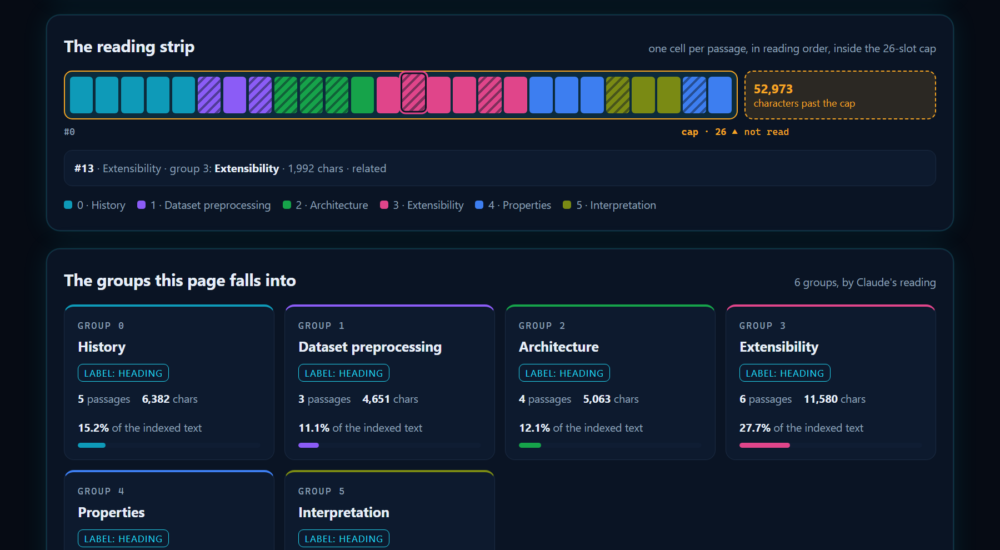

# GetLoopLoop skills

Agent Skills from [GetLoopLoop](https://www.getlooploop.com), for Claude Code and other agents that load `SKILL.md` skills.

| Skill | What it does |
|---|---|
| [`vectorscope`](skills/vectorscope/SKILL.md) | Shows how a retrieval system reads one public page: the product's exact fetch, extraction, chunking and 26-passage cap, with the passages grouped into topics by Claude's reading instead of embeddings. |

## In plain words

Before an AI assistant can quote your page, a machine has to read it, and it does not read it the way you do. It fetches the page once, throws away the menus, buttons and footers, and keeps the readable text. It cuts that text into passages of roughly 2,000 characters each, mostly at your section headings. Then it keeps at most 26 of them. Anything after the 26th passage is never stored, so no question can ever bring it back.

This skill runs those same steps on any public page and shows you the result:

- how many words survived, and how many passages they became;
- whether the page hit the 26-passage limit, and how much text fell past it;
- which passages talk about the same thing, grouped into a handful of topics;
- the words the page keeps using, split into the ones that run through the whole page and the ones that belong to one section;
- passages that look like related links or small print rather than content.

What it does **not** do: it does not rank your page, give it a score, detect AI-written text, or predict what any assistant will say about you. It shows what a retriever receives, nothing more.

Why the groups are "Claude's reading": the live tool groups passages by comparing their embeddings (lists of numbers that stand for meaning). This skill makes no model or embedding calls, so Claude reads the passages and groups them by subject instead. The fetching, the cutting and the 26-passage limit are the tool's exact rules; the grouping is a judgement, and two runs can group a page slightly differently. For the embedding-based reading with the map, use the free tool at https://www.getlooploop.com/vectorscope.

## What you get

One self-contained HTML report (no external fonts, scripts or images, so it opens offline), plus the same reading as Markdown and as JSON.

The top of the report for a page that hits the cap, in the dark and the light theme:


The reading strip: one cell per passage in reading order, coloured by group, inside the 26-slot frame, with the text past the cap drawn as an amber block. Hover or focus a cell to see its passage, heading and group:



On a narrow screen:


Two real runs are in [`examples/`](examples): the Wikipedia article on large language models, which fills every slot and leaves about 53,000 characters unread ([HTML](examples/wikipedia-llm.html), [Markdown](examples/wikipedia-llm.md), [JSON](examples/wikipedia-llm.json)), and the Vectorscope page itself, which needs 17 passages and loses nothing ([HTML](examples/getlooploop-vectorscope.html), [Markdown](examples/getlooploop-vectorscope.md), [JSON](examples/getlooploop-vectorscope.json)).

## Install

Copy or symlink a skill folder into your skills directory. For Claude Code that is `~/.claude/skills/` (personal) or `.claude/skills/` (per project):

```
cp -r skills/vectorscope ~/.claude/skills/vectorscope
cd ~/.claude/skills/vectorscope && npm install --omit=dev
```

The skill needs Node 18 or later. Its only dependency is [cheerio](https://cheerio.js.org/).

## Vectorscope, in short

```
node scripts/read.mjs https://example.com/page --out reading.json   # fetch → extract → chunk → cap
# Claude reads the passages and writes groups.json
node scripts/lens.mjs reading.json groups.json --md report.md --json export.json --html report.html
```

The scripts make no model or embedding calls and send nothing anywhere except the one GET for the page. Fields that would need vectors (cohesion, self-similarity, the projection) are reported as `null` instead of being estimated. The HTML report escapes every piece of page text and carries a content security policy that blocks all network requests from it, because the passages are third-party content. For the embedding-based reading with the semantic map, use the free tool at https://www.getlooploop.com/vectorscope.

## Licence

Free to use, change and share under the MIT licence, see [LICENSE](LICENSE). If you publish something built with it, a link to [getlooploop.com](https://www.getlooploop.com) is appreciated.
