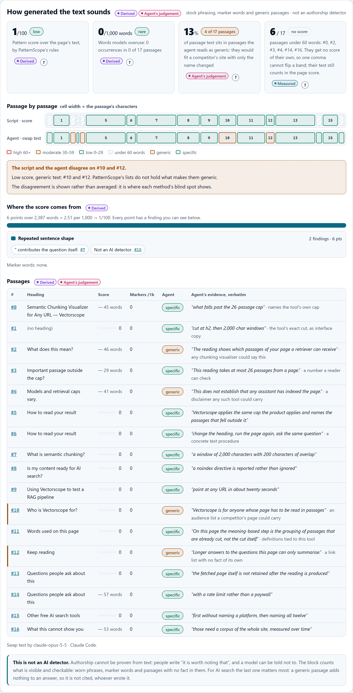
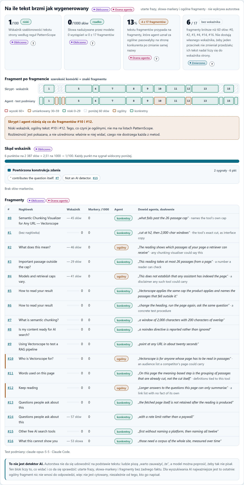
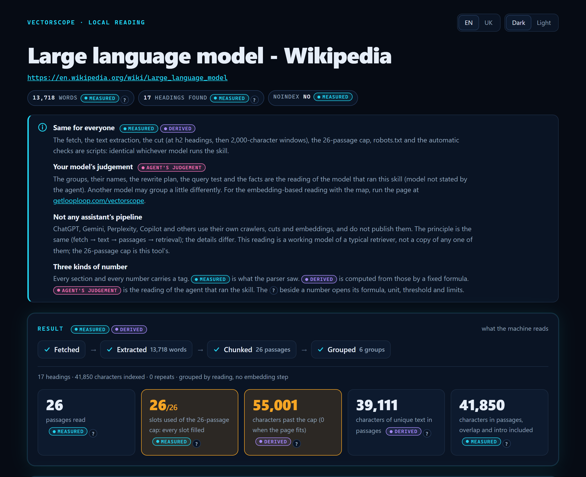
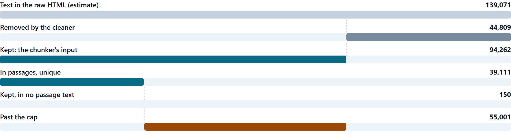
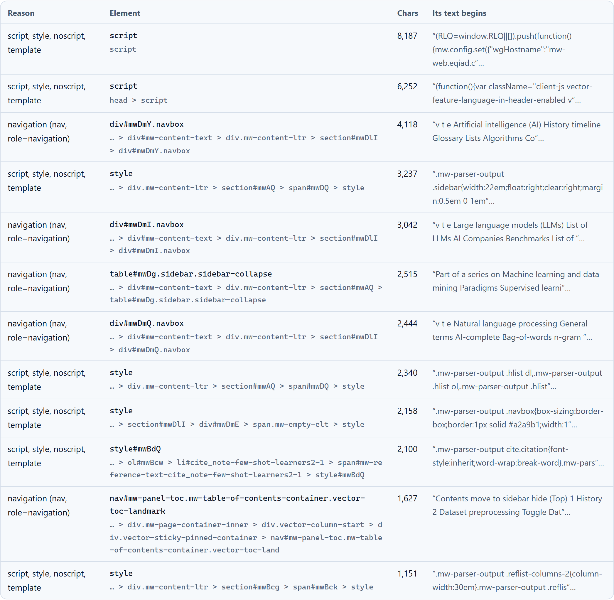
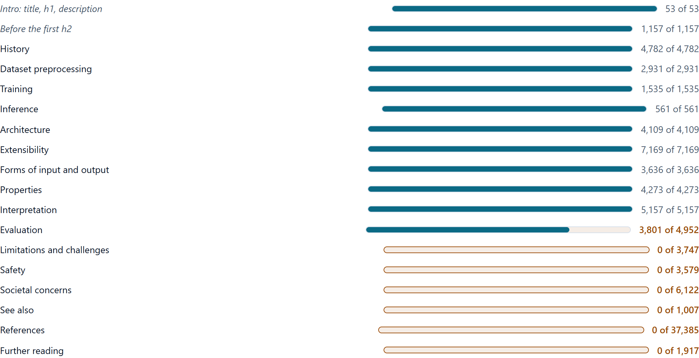
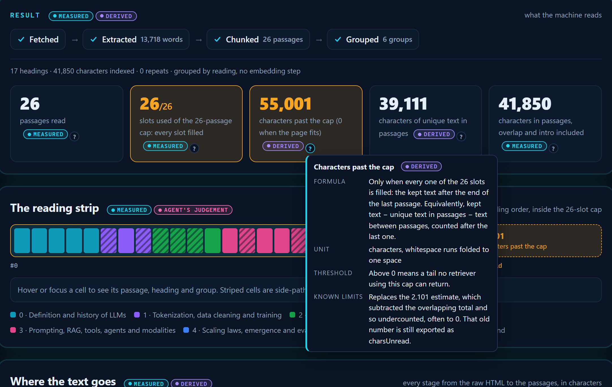

[English](README.md) · [Українська](README.uk.md) · Polski

# Skille GetLoopLoop

Skill Vectorscope **2.112**. Wersje liczymy w tysięcznych (2.101, 2.102, …), więc pierwsza liczba zmienia się tylko przy zmianie niezgodnej wstecz.

Agent Skills od [GetLoopLoop](https://www.getlooploop.com) dla claude.ai i aplikacji Claude na komputer, Claude Code, Codex, opencode, Hermes Agent i innych agentów, które wczytują skille w formacie `SKILL.md`.

| Skill | Co robi |
|---|---|
| [`vectorscope`](skills/vectorscope/SKILL.md) | Pokazuje, jak system wyszukiwania czyta publiczne strony: dokładnie te same pobieranie, wyodrębnianie tekstu, podział na fragmenty i limit 26 fragmentów co w produkcie, werdykty robots.txt dla crawlerów AI, automatyczne kontrole struktury, na ile tekst brzmi jak wygenerowany, a także grupowanie, test zapytań i plan przeredagowania przygotowane przez agenta. Porównuje od 2 do 5 stron. Raport jest po angielsku, ukraińsku i polsku. |

## Po ludzku

Zanim asystent AI zacytuje Twoją stronę, musi ją przeczytać maszyna, a ta nie czyta jej tak jak Ty. Pobiera stronę raz, wyrzuca menu, przyciski i stopki, a resztę tnie na fragmenty po mniej więcej 2000 znaków. Zachowuje najwyżej 26. Każdy fragment jest potem wyszukiwany i cytowany **samodzielnie**, bez reszty strony.

Ten skill przepuszcza dowolną publiczną stronę przez te same kroki i mówi, co poprawić: czy crawlery AI w ogóle mają wstęp, które fragmenty straciły swoje pytanie albo swój temat, co nie zmieściło się w limicie 26 fragmentów, na które typowe pytania strona odpowiada, a na które nie, na ile szablonowo brzmi tekst i które fragmenty nie mówią niczego, czego nie mogłaby powiedzieć strona konkurencji, oraz jak przeredagować najsłabsze fragmenty, żeby każdy obronił się sam.

Nie ustala pozycji Twojej strony, nie rozstrzyga, kto ją napisał, i nie przewiduje, co powie o Tobie którykolwiek asystent.

## Funkcje

- **Odczyt oczami maszyny:** dokładnie te same pobieranie, wyodrębnianie, podział na fragmenty i limit 26 fragmentów co w działającym narzędziu; ile słów zostaje, na ile fragmentów się dzielą, co wypada poza limit.
- **Zmierzono, obliczono, ocena:** każda sekcja i każda liczba ma etykietę mówiącą, czy zmierzył ją parser, wyliczył stały wzór, czy oszacował agent; eksport dzieli się w ten sam sposób na `measured` i `judgement`.
- **Na ile tekst brzmi jak wygenerowany** (2.111, ostatnia rozwinięta sekcja, nad *Dokąd trafia tekst*): wskaźnik szablonowości z [PatternScope](https://www.getlooploop.com/patternscope) GetLoopLoop liczony dla tekstu strony (oklepane frazy, powtarzalna budowa zdań, zdania zaczynające się tak samo, twierdzenia bez żadnej liczby ani nazwy; reguły narzędzia webowego, z dwiema poprawkami na całą stronę zamiast wklejonego tekstu, dla angielskiego, ukraińskiego i hiszpańskiego), obok niego słowa, których modele językowe nadużywają, oraz test podmiany wykonany przez agenta: które fragmenty pasowałyby do strony konkurencji po samej zmianie nazwy. Fragment po fragmencie, z ustaleniami stojącymi za każdym punktem; tam, gdzie skrypt i agent się nie zgadzają, pokazane są oba wyniki. Blok nie wykrywa autorstwa i mówi to wprost.
- **Dokąd trafia tekst** (na końcu raportu, zwinięte pod wierszem z liczbą znaków poza limitem): kaskada znaków od surowego HTML do fragmentów (usunięte przez czyszczenie, zachowane, we fragmentach bez podwójnego liczenia zakładek, poza limitem), tabela tego, co czyszczenie usunęło i dlaczego (element, jego ścieżka CSS, liczba znaków, początek tekstu) oraz mapa tego, ile z każdej sekcji trafiło do fragmentu.
- **Każda liczba wyjaśniona:** „?” obok liczby otwiera jej wzór, jednostkę, próg i znane ograniczenia, po angielsku, ukraińsku lub polsku; Markdown kończy się tą samą listą, a eksport zawiera ją jako słownik `metrics`.
- **Uczciwa liczba znaków poza limitem:** znaki poza limitem liczone są od unikalnego tekstu we fragmentach, więc strona, której limit uciął końcówkę, nie pokazuje już 0; liczba z 2.101 zostaje w eksporcie jako `charsUnread`.
- **Najpierw crawlery AI:** robots.txt sprawdzany dla GPTBot, OAI-SearchBot, ChatGPT-User, ClaudeBot, Claude-SearchBot, Claude-User, PerplexityBot, Perplexity-User, Google-Extended, Googlebot, Bingbot i CCBot, z dopasowaniem według RFC 9309. Jeśli crawlery, które odpowiadają ludziom, są zablokowane, raport mówi o tym przed wszystkim innym.
- **Automatyczne kontrole**, każda z kodem, fragmentami, na których się opiera, i dowodami: odpowiedzi FAQ, które zgubiły swoje pytania, jeden nagłówek niosący zbyt dużą część strony, fragmenty ucięte w środku zdania, nawigacja wewnątrz treści, cienkie sekcje, ucięte zajawki, to samo twierdzenie w każdej sekcji, canonical, JSON-LD i meta description.
- **Nagłówki odpowiedzi i dostępność:** nagłówki `X-Robots-Tag` i `Cache-Control` są odczytywane i sprawdzane (noindex w nagłówku jest równie poważny jak w meta robots), a obrazy i kolejność nagłówków na stronie są sprawdzane pod kątem brakującego tekstu alternatywnego, alt będącego samą nazwą pliku, przeskoków poziomów i wielu h1.
- **Słownictwo strony, najpierw frazy:** frazy z dwóch do czterech słów, które należą do strony, uszeregowane według liczby fragmentów, w których występują, a dalej słowa narracji. To, co mówi strona, a nie popyt w wyszukiwarce.
- **Grupowanie według odczytu agenta:** fragmenty pogrupowane według tematu i nazwane, przy czym własny nagłówek strony lub słowa kluczowe pozostają źródłem etykiety.
- **Test zapytań:** od 5 do 10 typowych pytań (Twoich albo agenta), najlepszy fragment dla każdego, czy odpowiada w pełni i dokładne słowa, które mógłby zacytować retriever.
- **Plan przeredagowania:** poprawki uszeregowane według priorytetu i powiązane z kontrolami, z przykładami „przed → po” dla najsłabszych fragmentów.
- **Porównanie od 2 do 5 stron** na jednym wspólnym słowniku tematów: tabela tematy × strony, luki tematyczne, luki w faktach i kto wygrywa każde zapytanie.
- **Przed i po:** porównanie strony z jej wcześniejszym odczytem.
- **Opcjonalne renderowanie JavaScriptu** w lokalnym Chrome lub Chromium, żeby zobaczyć, jaka część strony istnieje dopiero po uruchomieniu skryptów.
- **Jeden samodzielny raport HTML** bez żadnych żądań sieciowych, czytelny na telefonie, z interfejsem po angielsku, ukraińsku lub polsku; do tego Markdown i JSON.

Dlaczego grupy to „odczyt agenta”: działające narzędzie grupuje fragmenty, porównując ich embeddingi. Ten skill nie wywołuje żadnych modeli ani embeddingów, więc agent, który go uruchamia, sam czyta fragmenty i grupuje je według tematu. Pobieranie, cięcie, limit i kontrole są deterministyczne; grupowanie, werdykty zapytań i plan to ocena, a skrypty weryfikują każdy z tych elementów (każdy cytat musi być dosłownie wzięty ze swojego fragmentu). Odczyt oparty na embeddingach, z mapą, daje bezpłatne narzędzie pod adresem https://www.getlooploop.com/vectorscope.

## Co dostajesz

Na ile tekst brzmi jak wygenerowany: wskaźnik szablonowości, słowa-markery, test podmiany wykonany przez agenta, dwa paski obok siebie i każdy fragment z dowodami:



Ten sam blok z interfejsem po polsku:



Etykiety obok każdej sekcji i liczby oraz panel informacyjny, który je wyjaśnia:



Dokąd trafia tekst, od surowego HTML do fragmentów:



Co usunęło czyszczenie, od największych elementów, i ile z każdej sekcji trafiło do fragmentu:





„?” obok liczby: jej wzór, jednostka, próg i ograniczenia:



Góra raportu: potok, liczniki i pasek odczytu:


Ten sam raport z włączonym ciemnym motywem:


Ten sam raport z interfejsem po ukraińsku (treść strony nigdy nie jest tłumaczona):


Kontrole: najpierw tabela crawlerów AI, potem znaczniki techniczne i ustalenia, każde z fragmentami i wskazówką, co zrobić:


Plan przeredagowania z przykładami „przed → po”:


Test zapytań:


Słownictwo strony: najpierw frazy, które do niej należą, potem słowa narracji:


Porównanie dwóch stron: tematy × strony, luki tematyczne i kto wygrywa każde zapytanie:


Stopka i raport na telefonie:


W [`examples/`](examples) są trzy prawdziwe uruchomienia, a pliki napisane przez agenta leżą w [`examples/judgement/`](examples/judgement). Dwa raporty pojedynczych stron zostały 18 października wygenerowane ponownie wersją 2.111; porównanie to raport z wersji 2.110, bo web.dev deklaruje teraz wersję rosyjską, a porównanie wymaga dwóch stron, które da się przeczytać:

- sama strona Vectorscope, której wystarcza 17 fragmentów i która nic nie traci przez limit; jej wskaźnik szablonowości to 1 na 100, bez słów-markerów, a test podmiany uznaje za ogólnikowe 4 z 17 fragmentów ([HTML](examples/getlooploop-vectorscope.html), [Markdown](examples/getlooploop-vectorscope.md), [JSON](examples/getlooploop-vectorscope.json));
- artykuł Wikipedii o dużych modelach językowych, który zajmuje wszystkie miejsca i zostawia 55 001 znaków poza limitem, a sześć sekcji nie trafia do żadnego fragmentu; jego wskaźnik szablonowości to 10 na 100, prawie w całości z formatów cytowań w przypisach, a test podmiany uznaje za ogólnikowe 3 z 26 fragmentów ([HTML](examples/wikipedia-llm.html), [Markdown](examples/wikipedia-llm.md), [JSON](examples/wikipedia-llm.json));
- przewodnik MDN po cache'owaniu HTTP w zestawieniu z artykułem web.dev o pamięci podręcznej HTTP; MDN zajmuje wszystkie miejsca i od wersji 2.103 nic nie zostaje poza limitem: jego h3 „Validation” nie rozcina już sekcji „Common caching patterns”, a miejsce, które zajmowało to cięcie, mieści teraz ostatnią sekcję strony ([HTML](examples/http-caching-compare.html), [Markdown](examples/http-caching-compare.md), [JSON](examples/http-caching-compare.json)).

## Instalacja

Skill potrzebuje Node 20.18 lub nowszego (tego wymaga cheerio) i **nie potrzebuje `npm install`**: `dist/read.mjs` i `dist/lens.mjs` to skrypty zbudowane razem z ich jedyną zależnością, [cheerio](https://cheerio.js.org/), więc uruchamia je zwykły `node`, także w piaskownicach, które blokują instalowanie pakietów. Czytelny kod źródłowy jest w `scripts/`; `dist/` jest z niego generowany (zob. *Praca nad skillem*).

### Jednym poleceniem (Claude Code, Codex, opencode i inni agenci)

```
npx skills add Olexan-art/getlooploop-skills --skill vectorscope
```

[Narzędzie skills](https://skills.sh) zapyta, dla których agentów zainstalować skill (dodaj `-g`, żeby działał we wszystkich projektach, albo `-a claude-code`, żeby wybrać jednego agenta). Potem poproś agenta: „run vectorscope on <url>”.

### claude.ai i aplikacja Claude na komputer

1. Pobierz **`vectorscope.zip`** z sekcji [Releases](https://github.com/Olexan-art/getlooploop-skills/releases) tego repozytorium. Nie rozpakowuj go: przesyła się sam zip, z folderem `vectorscope` na najwyższym poziomie.
2. Włącz wykonywanie kodu: **Settings > Capabilities > Code execution and file creation**. Skille go wymagają. W planach Team i Enterprise kontroluje to właściciel w Organization settings > Capabilities.
3. Prześlij skill: **Customize > Skills**, przycisk **+**, **Create skill**, **Upload a skill**, a potem wybierz `vectorscope.zip`. Włącz skill na liście. W aplikacji na komputer to ta sama strona Customize > Skills.
4. Pozwól piaskownicy dotrzeć do strony, którą chcesz przeczytać. Uruchomienie pobiera stronę i jej `robots.txt`, a wykonywanie kodu sięga tylko tam, na co pozwala jego ustawienie sieci. W planach Free, Pro i Max to ustawienie **Allow network egress** w Settings > Capabilities. W planach Team i Enterprise wybiera właściciel w Organization settings > Capabilities: wyłączone, tylko menedżery pakietów (domyślnie), menedżery pakietów i wskazane domeny albo wszystkie domeny. Przy wskazanych domenach dodaj domenę strony. Jeśli ustawienie w Twoim planie nie dopuszcza tej strony, uruchomienie zatrzyma się z `REFUSED unreachable` i to powie; dla takiej strony użyj Claude Code albo innego agenta na własnym komputerze.
5. Na czacie poproś: **„run vectorscope on https://example.com/page”**. Claude uruchomi skrypty w piaskownicy i przekaże Ci `report.html` jako plik do pobrania i otwarcia w przeglądarce, a na czacie napisze krótkie podsumowanie.

**Wklejenie linku do tego repozytorium na czacie to nie instalacja.** Claude słusznie nie pobierze i nie uruchomi kodu z linku, który ktoś wkleił, więc w najlepszym razie odtworzy kroki ręcznie, a takie liczby nie pochodzą z narzędzia. Prześlij zip, jak opisano wyżej.

Źródła: [Use skills in Claude](https://support.claude.com/en/articles/12512180-use-skills-in-claude) · [Create custom skills](https://claude.com/docs/skills/how-to) (struktura zipa, zasady dla nazwy i opisu) · [Create and edit files with Claude](https://support.claude.com/en/articles/12111783-create-and-edit-files-with-claude) (wykonywanie kodu i dostęp do sieci) · [Agent Skills overview](https://platform.claude.com/docs/en/agents-and-tools/agent-skills/overview) (dostęp do sieci w zależności od platformy). Sprawdzono 16.10.2026.

### Brak internetu w powłoce agenta

Piaskownice w chmurze często uruchamiają powłokę bez sieci albo nie pozwalają zapisywać w folderze skilli. Skill nie potrzebuje folderu skilli: rozpakuj `vectorscope.zip` w dowolnym miejscu, w którym agent może zapisywać, i wskaż mu ten folder (albo dołącz zip do czatu). Bez sieci zapisz stronę w przeglądarce jako „Strona internetowa, tylko HTML” i, jeśli możesz, jej `robots.txt`, a potem przekaż oba pliki agentowi: skill przeczyta zapisaną kopię i oznaczy każdą kontrolę, która wymaga sieci, jako niesprawdzoną.

## Używanie z agentem

Skill to jeden folder, `skills/vectorscope`, z plikiem `SKILL.md` i skryptami w Node. Agenci obsługujący Agent Skills wczytują go ze swojego folderu skilli; każdy inny agent może wykonywać `SKILL.md` jako instrukcję. W obu przypadkach agent uruchamia te same skrypty z folderu skilla, a czyta model samego agenta. Bez kroku instalacji: agent uruchamia `node dist/read.mjs` i `node dist/lens.mjs` tak, jak są.

```
git clone https://github.com/Olexan-art/getlooploop-skills.git
```

**Claude Code** wczytuje osobiste skille z `~/.claude/skills/`, a skille projektu z `.claude/skills/`.

```
mkdir -p ~/.claude/skills && cp -r getlooploop-skills/skills/vectorscope ~/.claude/skills/vectorscope   # personal
mkdir -p .claude/skills && cp -r getlooploop-skills/skills/vectorscope .claude/skills/vectorscope       # or: this project only
```

```powershell
New-Item -ItemType Directory -Force "$HOME\.claude\skills" | Out-Null
Copy-Item -Recurse getlooploop-skills\skills\vectorscope "$HOME\.claude\skills\vectorscope"
```

**OpenAI Codex (CLI, rozszerzenie IDE, aplikacja)** przegląda `$HOME/.agents/skills` (poziom użytkownika) i `.agents/skills` w każdym folderze od miejsca uruchomienia aż do katalogu głównego repozytorium (poziom repozytorium).

```
mkdir -p ~/.agents/skills && cp -r getlooploop-skills/skills/vectorscope ~/.agents/skills/vectorscope
```

```powershell
New-Item -ItemType Directory -Force "$HOME\.agents\skills" | Out-Null
Copy-Item -Recurse getlooploop-skills\skills\vectorscope "$HOME\.agents\skills\vectorscope"
```

**opencode** wczytuje globalne skille z `~/.config/opencode/skills/`, `~/.claude/skills/` lub `~/.agents/skills/`, a skille projektu z `.opencode/skills/`, `.claude/skills/` lub `.agents/skills/` (idąc w górę aż do korzenia drzewa roboczego git). Kopię zrobioną wyżej dla Claude Code lub Codex też wykryje; w przeciwnym razie:

```
mkdir -p ~/.config/opencode/skills && cp -r getlooploop-skills/skills/vectorscope ~/.config/opencode/skills/vectorscope
```

**Hermes Agent (Nous Research)** trzyma skille w `~/.hermes/skills/`. Czyta też `<project>/.hermes/skills/` i `<project>/.agents/skills/`, gdy oznaczysz repozytorium jako zaufane poleceniem `hermes skills trust`, oraz każdy folder wymieniony w `skills.external_dirs` w `~/.hermes/config.yaml` (na przykład `~/.agents/skills`).

```
mkdir -p ~/.hermes/skills && cp -r getlooploop-skills/skills/vectorscope ~/.hermes/skills/vectorscope
```

**GLM** (Zhipu / Z.ai) to rodzina modeli, a nie agent. GLM Coding Plan od Z.ai działa wewnątrz agentów programistycznych; jego dokumentacja wymienia wśród nich Claude Code, Codex i OpenCode. Zainstaluj skill dla agenta, w którym używasz GLM, jak opisano wyżej: skill działa wtedy według instrukcji tego agenta, a czyta GLM.

**Każdy inny agent:** wskaż skill w jego pliku instrukcji (na przykład `AGENTS.md`), żeby przeczytał kroki, zanim zacznie:

```
For questions about how AI assistants read a web page, follow skills/vectorscope/SKILL.md and run its scripts from that folder.
```

Źródła: [skille Claude Code](https://code.claude.com/docs/en/skills) · [skille Codex](https://learn.chatgpt.com/docs/build-skills) (tu przekierowuje teraz developers.openai.com/codex/skills) · [skille opencode](https://opencode.ai/docs/skills) · [skille Hermes Agent](https://hermes-agent.nousresearch.com/docs/user-guide/features/skills) · [GLM Coding Plan od Z.ai](https://docs.z.ai/devpack/overview). Sprawdzono 16.10.2026; foldery skilli zmieniają się między wydaniami, więc jeśli ścieżka nie działa, sprawdź aktualną dokumentację swojego agenta.

## Vectorscope w skrócie

```
node dist/read.mjs https://example.com/page --out reading.json   # fetch → extract → chunk → cap, robots.txt, checks
# the agent reads the passages and writes groups.json
node dist/lens.mjs reading.json groups.json --html report.html   # labels, phrases, all checks
# the agent writes queries.json, style.json and plan.json
node dist/lens.mjs reading.json groups.json --queries queries.json --style style.json --plan plan.json --html report.html --md report.md --json export.json

node dist/read.mjs <url1> <url2> --out-dir readings              # compare; then topics.json, groups-<n>.json, facts.json, queries.json
node dist/lens.mjs --compare readings/manifest.json --html readings/compare.html
```

Skrypty nie wywołują żadnych modeli ani embeddingów i nie wysyłają niczego nigdzie poza żądaniami GET po stronę i jej robots.txt (a z `--render` stronę wczytuje jeszcze lokalna przeglądarka). Pola, które wymagałyby wektorów (spójność, samopodobieństwo, projekcja), są podawane jako `null`, a nie szacowane. Raport HTML escapuje każdy kawałek tekstu strony i ma politykę bezpieczeństwa treści (CSP), która blokuje z niego wszystkie żądania sieciowe, bo fragmenty to treść pochodząca od osób trzecich.

## AI Search Audit Lite

AI Search Audit Lite, czyli audyt SEO i wyszukiwania AI jednej strony, który łączy odczyt Vectorscope z listą kontrolną Google i Bing, robots.txt, danymi strukturalnymi i wersjami językowymi, przeniósł się do własnego repozytorium: **[Olexan-art/ai-search-audit](https://github.com/Olexan-art/ai-search-audit)**, gdzie są kroki instalacji, przykłady, zrzuty ekranu, a zip dla claude.ai w jego Releases. Instalacja: `npx skills add Olexan-art/ai-search-audit --skill ai-search-audit`.

## Jak zlecać agentowi

Krótkie zlecenie z jasnym warunkiem zatrzymania i formatem odpowiedzi trzyma agenta przy procedurze. Skopiuj je i wpisz swoją stronę:

```markdown
## Task
Run the skill `vectorscope` on 1 page. Write its report.

## Inputs
- Page: https://example.com/page
- Working folder: ./vectorscope
- Compare with (optional, at most 4): https://example.com/other

## Rules
1. Read SKILL.md first. Follow it exactly.
2. Write every file into the working folder.

## Stop condition
Stop when report.html exists. Show it.

## Reply format
- The report link or path.
- The 3 main findings, with the passages they cite.
```

## Praca nad skillem

`scripts/` to kod źródłowy; `dist/` jest z niego budowany za pomocą [esbuild](https://esbuild.github.io/) (tylko zależność deweloperska) i commitowany, więc skill działa bez instalacji.

```
cd skills/vectorscope
npm install          # cheerio, and esbuild for the build
npm run build        # scripts/ → dist/read.mjs, dist/lens.mjs (not minified, readable)
npm test             # includes a check that dist/ equals a fresh build, so dist never drifts from scripts/
npm run zip          # dist-release/vectorscope.zip, the file to attach to a release for claude.ai
```

Po zmianie `scripts/` uruchom `npm run build` i commituj jedno i drugie.

## Licencja

Możesz go swobodnie używać, zmieniać i udostępniać na licencji MIT, zob. [LICENSE](LICENSE). Jeśli opublikujesz coś zbudowanego z jego pomocą, link do [getlooploop.com](https://www.getlooploop.com) będzie mile widziany.
