[English](README.md) · Українська

# Навички GetLoopLoop

Agent Skills від [GetLoopLoop](https://www.getlooploop.com) для claude.ai і застосунку Claude для комп’ютера, Claude Code, Codex, opencode, Hermes Agent та інших агентів, які завантажують навички у форматі `SKILL.md`.

| Навичка | Що робить |
|---|---|
| [`vectorscope`](skills/vectorscope/SKILL.md) | Показує, як система пошуку читає публічні сторінки: точні правила завантаження, видобування тексту, нарізання і ліміт у 26 уривків, як у продукті; вердикти robots.txt для ШІ-краулерів; автоматичні перевірки структури; групування, тест запитів і план переписування від агента. Порівнює від 2 до 5 сторінок. |

## Простими словами

Перш ніж ШІ-асистент зможе процитувати вашу сторінку, її має прочитати машина, і читає вона не так, як ви. Вона один раз завантажує сторінку, викидає меню, кнопки й футери, а решту ріже на уривки приблизно по 2 000 символів. Зберігає щонайбільше 26. Потім кожен уривок знаходять і цитують **окремо**, без решти сторінки.

Ця навичка проганяє будь-яку публічну сторінку тими самими кроками й підказує, що виправити: чи взагалі пускають ШІ-краулерів, які уривки втратили своє запитання чи свій предмет, що не вмістилося в ліміт у 26 уривків, на які типові запитання сторінка відповідає, а на які ні, і як переписати найслабші уривки, щоб кожен був самодостатнім.

Вона не ранжує сторінку, не ставить їй оцінку, не шукає тексту, написаного ШІ, і не передбачає, що про вас скаже будь-який асистент.

## Можливості

- **Читання очима машини:** точне завантаження, видобування, нарізання й ліміт у 26 уривків, як у живому інструменті; скільки слів лишилося, на скільки уривків вони поділилися, що вийшло за ліміт.
- **Спершу ШІ-краулери:** robots.txt перевіряється для GPTBot, OAI-SearchBot, ChatGPT-User, ClaudeBot, Claude-SearchBot, Claude-User, PerplexityBot, Perplexity-User, Google-Extended, Googlebot, Bingbot і CCBot за правилами RFC 9309. Якщо краулерам, які відповідають людям, закрито доступ, звіт каже про це раніше за все інше.
- **Автоматичні перевірки**, кожна з кодом, уривками, на яких вона ґрунтується, і доказами: відповіді FAQ, що загубили запитання; один заголовок, який несе забагато сторінки; уривки, розрізані посеред речення; навігація всередині вмісту; тонкі розділи; обрізані анонси; одне й те саме твердження в кожному розділі; canonical, JSON-LD і meta description.
- **Словник сторінки, спершу фрази:** фрази з двох–чотирьох слів, що належать сторінці, за кількістю уривків, де вони трапляються, а далі слова розповіді. Це те, що каже сторінка, а не пошуковий попит.
- **Групування за прочитанням агента:** уривки згруповано за темою й названо, а власний заголовок сторінки чи ключові слова лишаються як джерело мітки.
- **Тест запитів:** від 5 до 10 типових запитань (ваших або від агента), найкращий уривок для кожного, чи відповідає він повністю, і точні слова, які ретривер міг би процитувати.
- **План переписування:** виправлення за пріоритетом, прив’язані до перевірок, з прикладами «було → стало» для найслабших уривків.
- **Порівняння від 2 до 5 сторінок** на одному спільному словнику тем: таблиця «теми × сторінки», прогалини в темах, прогалини у фактах і хто виграє кожен запит.
- **До і після:** порівняння сторінки з її попереднім читанням.
- **Необов’язковий рендер JavaScript** у локальному Chrome чи Chromium, щоб побачити, скільки сторінки з’являється лише після виконання скриптів.
- **Один самодостатній HTML-звіт** англійською або українською (перемикач угорі), у світлій чи темній темі, зручний на телефоні, без жодних мережевих запитів; а також Markdown і JSON.

Чому групи — це «прочитання агента»: живий інструмент групує уривки, порівнюючи їхні ембединги. Ця навичка не викликає жодних моделей чи ембедингів, тому агент, який її запускає, сам читає уривки й групує їх за темою. Завантаження, нарізання, ліміт і перевірки детерміновані; групування, вердикти щодо запитів і план — це судження, і скрипти перевіряють кожне з них (кожна цитата має дослівно збігатися з текстом свого уривка). Читання на ембедингах із картою — у безкоштовному інструменті на https://www.getlooploop.com/vectorscope.

## Що ви отримуєте

Звіт з інтерфейсом українською (вміст сторінки ніколи не перекладається):

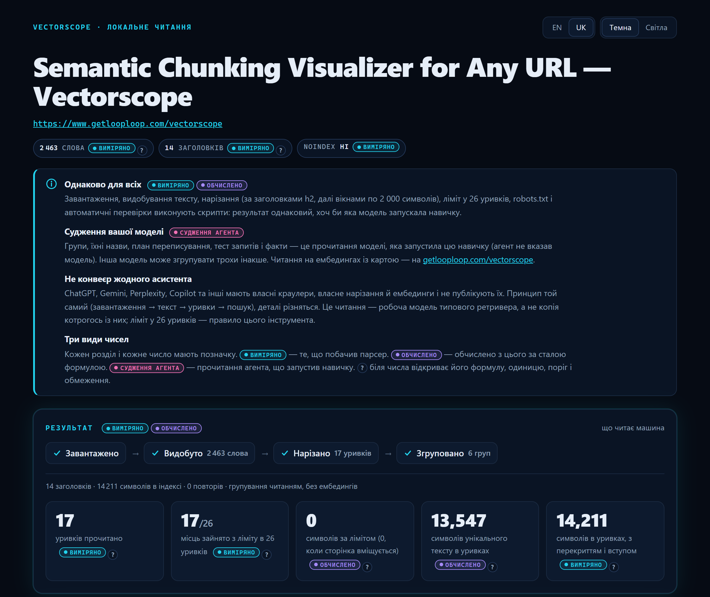

Верх звіту в темній і світлій темі:

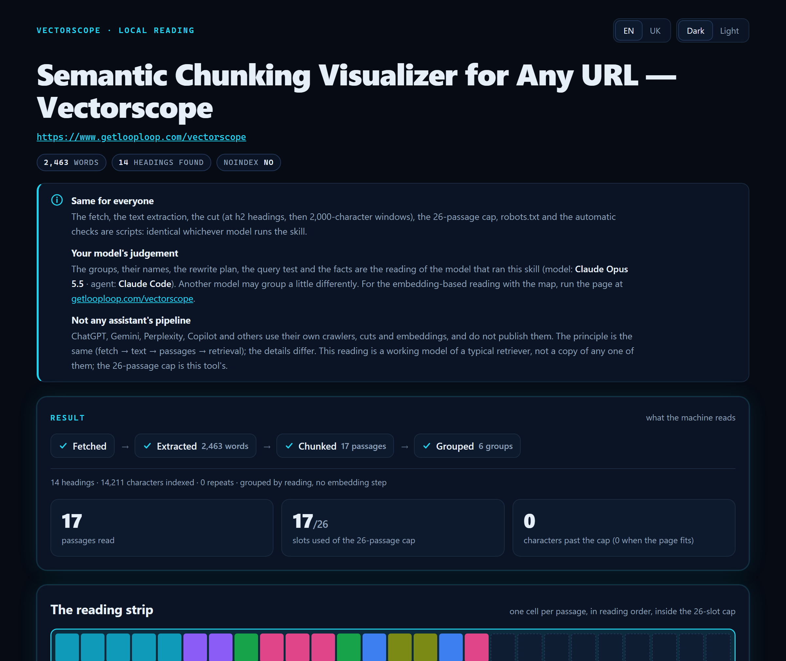

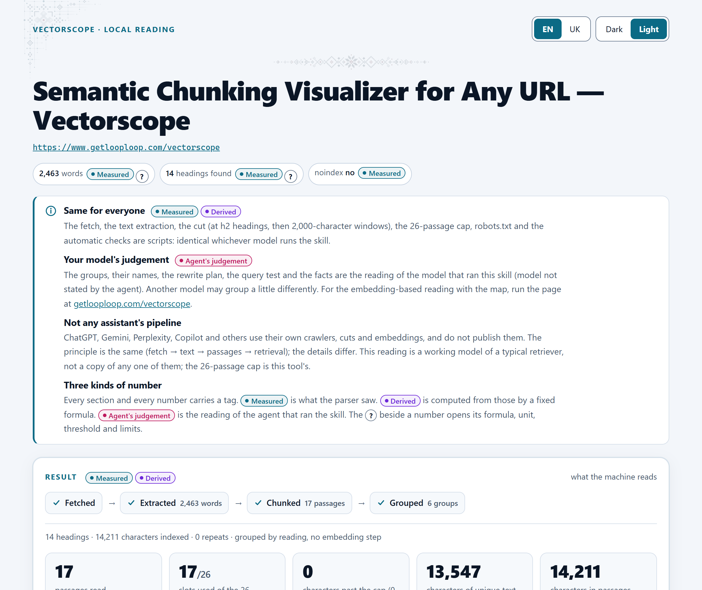

Перевірки: спершу таблиця ШІ-краулерів, далі технічна розмітка і знахідки, кожна з уривками й порадою, що робити:

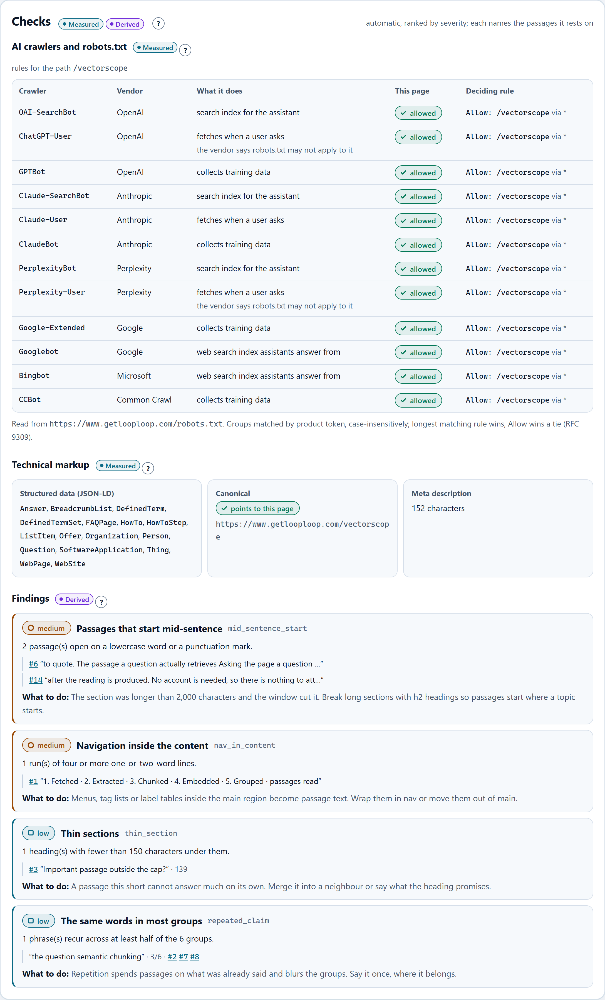

План переписування з прикладами «було → стало»:

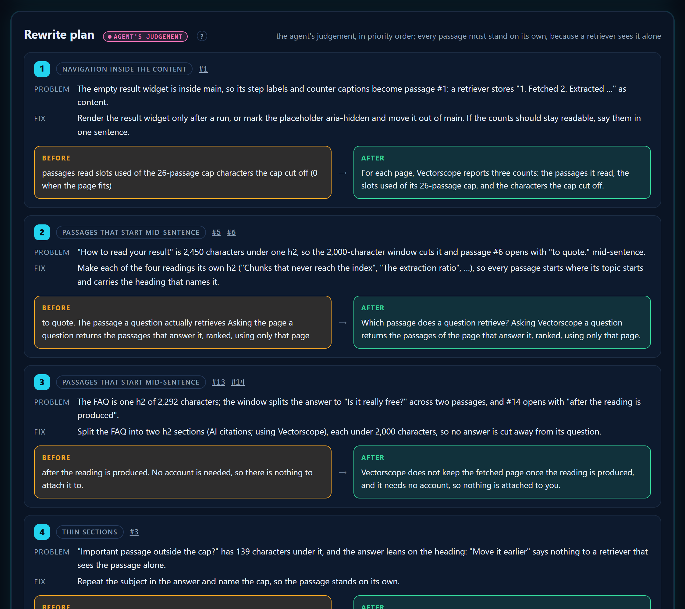

Тест запитів:

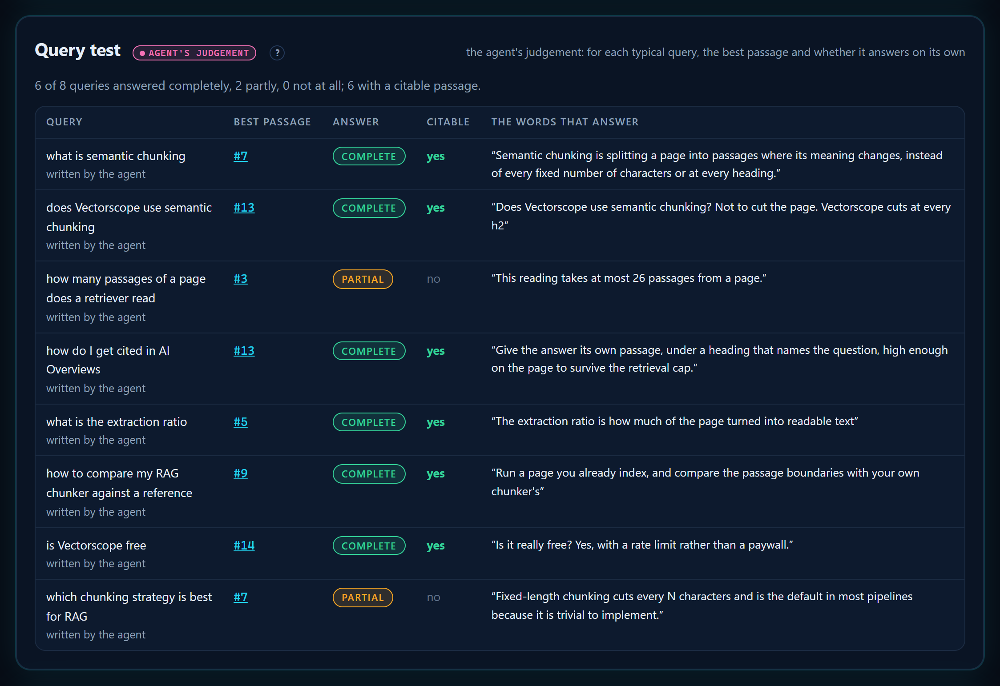

Словник сторінки: спершу фрази, що їй належать, далі слова розповіді:

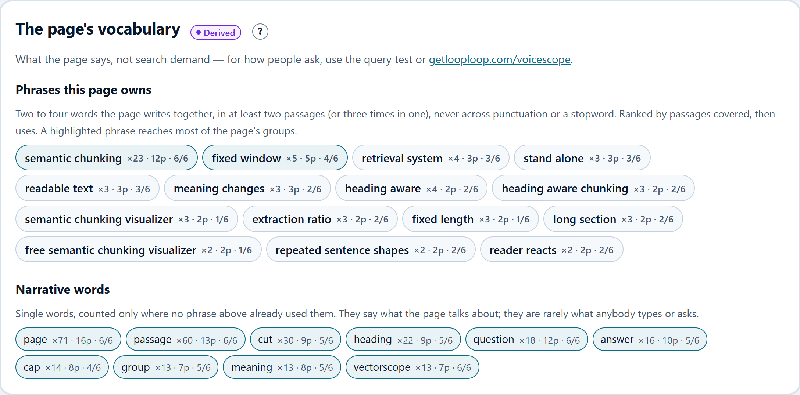

Порівняння двох сторінок: теми × сторінки, прогалини в темах і хто виграє кожен запит:

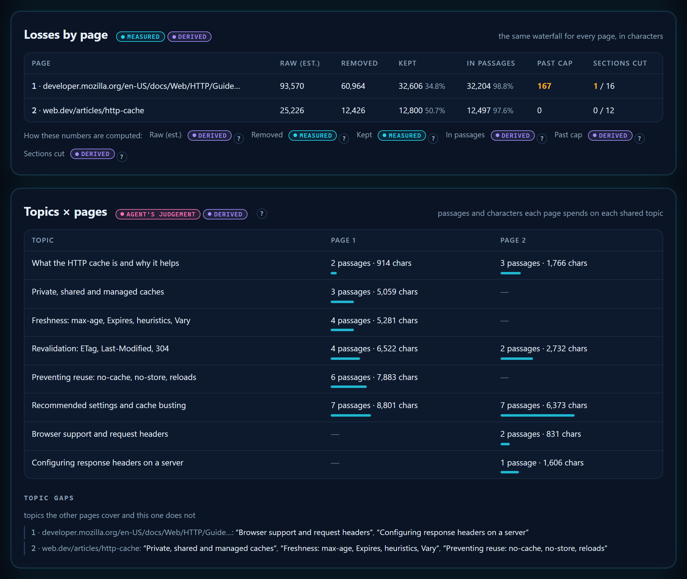

Футер і звіт на телефоні:

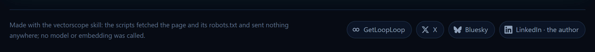

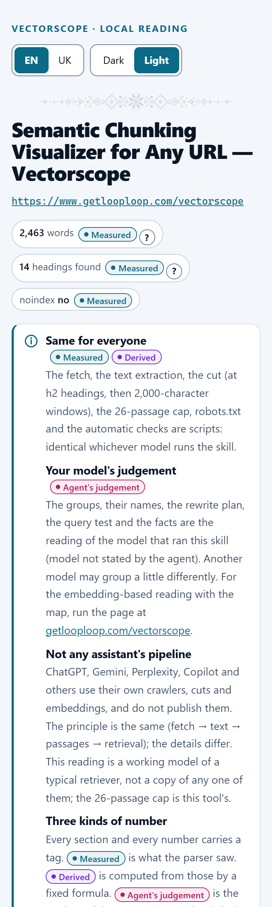

У теці [`examples/`](examples) лежать три справжні запуски, а файли, які написав агент, — у [`examples/judgement/`](examples/judgement):

- сама сторінка Vectorscope: їй вистачає 17 уривків, і нічого не губиться ([HTML](examples/getlooploop-vectorscope.html), [Markdown](examples/getlooploop-vectorscope.md), [JSON](examples/getlooploop-vectorscope.json));
- стаття Вікіпедії про великі мовні моделі: вона займає всі місця й лишає непрочитаними близько 53 000 символів ([HTML](examples/wikipedia-llm.html), [Markdown](examples/wikipedia-llm.md), [JSON](examples/wikipedia-llm.json));
- посібник MDN з HTTP-кешування проти статті web.dev про HTTP-кеш ([HTML](examples/http-caching-compare.html), [Markdown](examples/http-caching-compare.md), [JSON](examples/http-caching-compare.json)).

Звіти в прикладах англійською за замовчуванням; додайте `#lang=uk` до адреси або натисніть UK угорі.

## Встановлення

Навичці потрібен Node 20.18 або новіший (цього вимагає cheerio) і **не потрібен `npm install`**: `dist/read.mjs` і `dist/lens.mjs` — це скрипти, зібрані разом з їхньою єдиною залежністю, [cheerio](https://cheerio.js.org/), тож їх запускає звичайний `node`, зокрема в пісочницях, де встановлювати пакети заборонено. Читабельний код лежить у `scripts/`; `dist/` збирається з нього (див. *Робота над навичкою*).

### claude.ai і застосунок Claude для комп’ютера

1. Завантажте **`vectorscope.zip`** з розділу [Releases](https://github.com/Olexan-art/getlooploop-skills/releases) цього репозиторію. Не розпаковуйте його: завантажується сам zip, у якому на верхньому рівні лежить тека `vectorscope`.
2. Увімкніть виконання коду: **Settings > Capabilities > Code execution and file creation**. Без нього навички не працюють. У планах Team і Enterprise цим керує власник організації в Organization settings > Capabilities.
3. Завантажте навичку: **Customize > Skills**, кнопка **+**, **Create skill**, **Upload a skill**, далі виберіть `vectorscope.zip`. Увімкніть навичку в списку. У застосунку для комп’ютера це та сама сторінка Customize > Skills.
4. Дозвольте пісочниці доступ до сайту, який треба прочитати. Запуск завантажує сторінку та її `robots.txt`, а виконання коду бачить лише те, що дозволяє його мережеве налаштування. У планах Free, Pro і Max це **Allow network egress** у Settings > Capabilities. У планах Team і Enterprise власник вибирає в Organization settings > Capabilities: вимкнено, лише менеджери пакетів (за замовчуванням), менеджери пакетів і вказані домени або всі домени. Якщо вибрано вказані домени, додайте домен сайту. Якщо налаштування вашого плану не дозволяє цей сайт, запуск зупиниться з `REFUSED unreachable` і скаже про це; для такої сторінки скористайтеся Claude Code чи іншим агентом на своєму комп’ютері.
5. У чаті попросіть: **«прожени vectorscope для https://example.com/page»**. Claude запустить скрипти в пісочниці й віддасть `report.html` файлом, який можна завантажити й відкрити в браузері, а в чаті напише коротке резюме.

**Вставити посилання на цей репозиторій у чат — не те саме, що встановити навичку.** Claude слушно не завантажує й не запускає код за посиланням, яке хтось вставив, тож щонайбільше відтворить кроки вручну, а такі числа — не результат інструмента. Завантажте zip, як описано вище.

Джерела: [Use skills in Claude](https://support.claude.com/en/articles/12512180-use-skills-in-claude) · [Create custom skills](https://claude.com/docs/skills/how-to) (структура zip, правила для назви й опису) · [Create and edit files with Claude](https://support.claude.com/en/articles/12111783-create-and-edit-files-with-claude) (виконання коду й мережевий доступ) · [Agent Skills overview](https://platform.claude.com/docs/en/agents-and-tools/agent-skills/overview) (мережевий доступ на різних платформах). Перевірено 16.10.2026.

## Використання з вашим агентом

Навичка — це одна тека, `skills/vectorscope`, з файлом `SKILL.md` і скриптами на Node. Агенти з підтримкою Agent Skills завантажують її зі своєї теки навичок; будь-який інший агент може виконувати `SKILL.md` як інструкцію. В обох випадках агент запускає ті самі скрипти з теки навички, а читає уривки модель самого агента. Нічого встановлювати не треба: агент запускає `node dist/read.mjs` і `node dist/lens.mjs` як є.

```
git clone https://github.com/Olexan-art/getlooploop-skills.git
```

**Claude Code** завантажує особисті навички з `~/.claude/skills/`, а навички проєкту — з `.claude/skills/`.

```
mkdir -p ~/.claude/skills && cp -r getlooploop-skills/skills/vectorscope ~/.claude/skills/vectorscope   # особисто
mkdir -p .claude/skills && cp -r getlooploop-skills/skills/vectorscope .claude/skills/vectorscope       # або: лише цей проєкт
```

```powershell
New-Item -ItemType Directory -Force "$HOME\.claude\skills" | Out-Null
Copy-Item -Recurse getlooploop-skills\skills\vectorscope "$HOME\.claude\skills\vectorscope"
```

**OpenAI Codex (CLI, розширення для IDE, застосунок)** переглядає `$HOME/.agents/skills` (рівень користувача) і `.agents/skills` у кожній теці від місця запуску до кореня репозиторію (рівень репозиторію).

```
mkdir -p ~/.agents/skills && cp -r getlooploop-skills/skills/vectorscope ~/.agents/skills/vectorscope
```

```powershell
New-Item -ItemType Directory -Force "$HOME\.agents\skills" | Out-Null
Copy-Item -Recurse getlooploop-skills\skills\vectorscope "$HOME\.agents\skills\vectorscope"
```

**opencode** завантажує глобальні навички з `~/.config/opencode/skills/`, `~/.claude/skills/` або `~/.agents/skills/`, а навички проєкту — з `.opencode/skills/`, `.claude/skills/` або `.agents/skills/` (піднімаючись до кореня git). Копію, зроблену вище для Claude Code чи Codex, він теж підхопить; інакше:

```
mkdir -p ~/.config/opencode/skills && cp -r getlooploop-skills/skills/vectorscope ~/.config/opencode/skills/vectorscope
```

**Hermes Agent (Nous Research)** тримає навички в `~/.hermes/skills/`. Він також читає `<проєкт>/.hermes/skills/` і `<проєкт>/.agents/skills/`, щойно ви позначите репозиторій довіреним командою `hermes skills trust`, і будь-яку теку зі списку `skills.external_dirs` у `~/.hermes/config.yaml` (наприклад, `~/.agents/skills`).

```
mkdir -p ~/.hermes/skills && cp -r getlooploop-skills/skills/vectorscope ~/.hermes/skills/vectorscope
```

**GLM** (Zhipu / Z.ai) — це сімейство моделей, а не агент. GLM Coding Plan від Z.ai використовують усередині агентів для програмування; серед них його документація називає Claude Code, Codex і OpenCode. Встановіть навичку для того агента, у якому працює GLM, як описано вище: тоді навичка виконується за правилами цього агента, а читає уривки GLM.

**Будь-який інший агент:** вкажіть на навичку у файлі його інструкцій (наприклад, `AGENTS.md`), щоб він прочитав кроки, перш ніж почати:

```
For questions about how AI assistants read a web page, follow skills/vectorscope/SKILL.md and run its scripts from that folder.
```

Джерела: [навички Claude Code](https://code.claude.com/docs/en/skills) · [навички Codex](https://learn.chatgpt.com/docs/build-skills) (сюди тепер переспрямовує developers.openai.com/codex/skills) · [навички opencode](https://opencode.ai/docs/skills) · [навички Hermes Agent](https://hermes-agent.nousresearch.com/docs/user-guide/features/skills) · [GLM Coding Plan від Z.ai](https://docs.z.ai/devpack/overview). Перевірено 16.10.2026; теки навичок змінюються між версіями, тож якщо шлях не спрацював, звірте з актуальною документацією свого агента.

## Vectorscope коротко

```
node dist/read.mjs https://example.com/page --out reading.json   # завантаження → текст → уривки → ліміт, robots.txt, перевірки
# агент читає уривки й пише groups.json
node dist/lens.mjs reading.json groups.json --html report.html   # мітки, фрази, усі перевірки
# агент пише queries.json і plan.json
node dist/lens.mjs reading.json groups.json --queries queries.json --plan plan.json --html report.html --md report.md --json export.json

node dist/read.mjs <url1> <url2> --out-dir readings              # порівняння; далі topics.json, groups-<n>.json, facts.json, queries.json
node dist/lens.mjs --compare readings/manifest.json --html readings/compare.html
```

Скрипти не викликають жодних моделей чи ембедингів і нікуди нічого не надсилають, окрім GET-запитів до сторінки та її robots.txt (а з `--render` сторінку ще відкриває локальний браузер). Поля, для яких потрібні вектори (згуртованість, самоподібність, проєкція), подано як `null`, а не оцінено навмання. HTML-звіт екранує кожен шматок тексту сторінки й має політику безпеки вмісту, що блокує з нього всі мережеві запити, бо уривки — це вміст третьої сторони.

## Сторінки російською мовою не аналізуються

Vectorscope не аналізує сторінки російською мовою. Це рішення автора інструмента через війну Росії проти України. Сторінка російською отримує звіт із причиною та висновками, на які вона спирається, і нічого з самої сторінки: [Генеральна Асамблея ООН](https://news.un.org/en/story/2022/03/1113152) ([і](https://news.un.org/en/story/2022/10/1129492)), [Європейський парламент](https://www.europarl.europa.eu/news/en/press-room/20221118IPR55707/european-parliament-declares-russia-to-be-a-state-sponsor-of-terrorism), [Міжнародний кримінальний суд](https://www.icc-cpi.int/news/situation-ukraine-icc-judges-issue-arrest-warrants-against-vladimir-vladimirovich-putin-and), [Комісія ООН з розслідування щодо України](https://news.un.org/en/story/2025/03/1161281), [Офіс Генерального прокурора України](https://gp.gov.ua/en/posts/ponad-190-tisyac-vojennix-zlociniv-ofis-genprokurora-predstaviv-komisiyi-oon-masstabi-zlociniv-rf-proti-ukrayini).

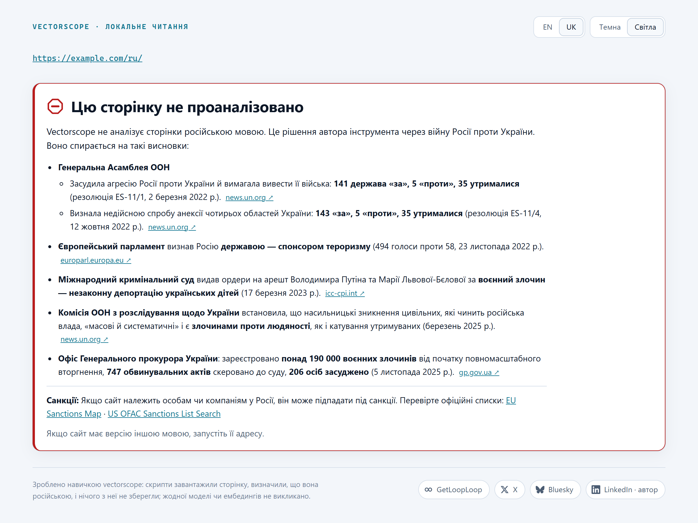

## Робота над навичкою

`scripts/` — це вихідний код; `dist/` збирається з нього за допомогою [esbuild](https://esbuild.github.io/) (лише залежність для розробки) і лежить у репозиторії, тож навичка працює без встановлення.

```
cd skills/vectorscope
npm install          # cheerio і esbuild для збирання
npm run build        # scripts/ → dist/read.mjs, dist/lens.mjs (без мініфікації, читабельно)
npm test             # серед іншого перевіряє, що dist/ збігається зі свіжим збиранням, тож dist не розходиться зі scripts/
npm run zip          # dist-release/vectorscope.zip — файл, який додають до релізу для claude.ai
```

Змінили `scripts/` — запустіть `npm run build` і закомітьте обидва.

## Ліцензія

Вільно використовуйте, змінюйте й поширюйте за ліцензією MIT, див. [LICENSE](LICENSE). Якщо публікуєте щось, зроблене з її допомогою, будемо вдячні за посилання на [getlooploop.com](https://www.getlooploop.com).
