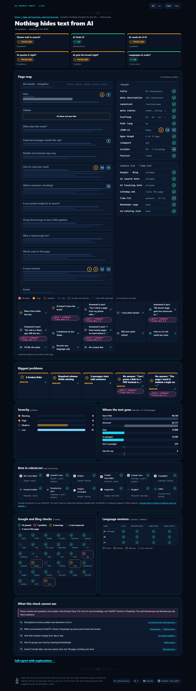
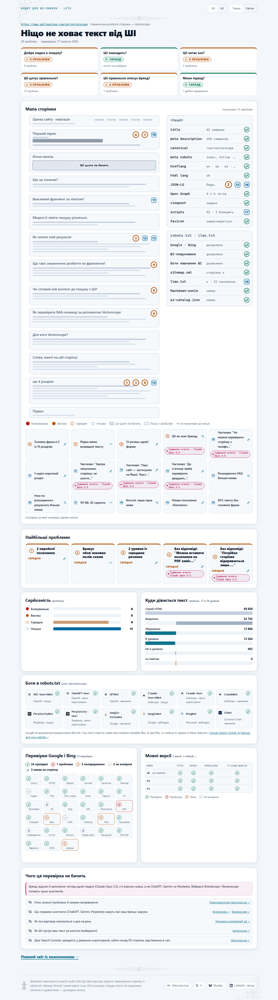
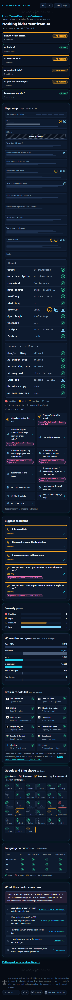
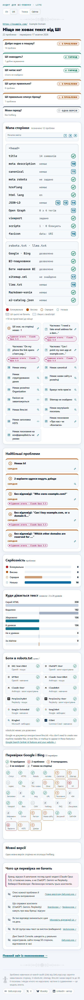
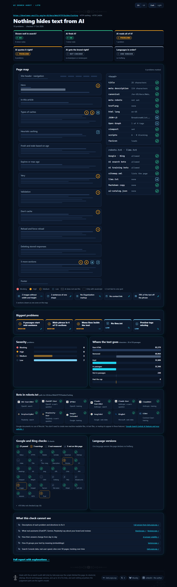

[English](README.md) · Українська

# Навички GetLoopLoop

Скіл Vectorscope **2.103** · AI Search Audit Lite **2.101**. Версії рахуються в тисячних (2.101, 2.102, …), тож перша цифра змінюється лише тоді, коли щось ламається несумісно.

Agent Skills від [GetLoopLoop](https://www.getlooploop.com) для claude.ai і застосунку Claude для комп’ютера, Claude Code, Codex, opencode, Hermes Agent та інших агентів, які завантажують навички у форматі `SKILL.md`.

| Навичка | Що робить |
|---|---|
| [`vectorscope`](skills/vectorscope/SKILL.md) | Показує, як система пошуку читає публічні сторінки: точні правила завантаження, видобування тексту, нарізання і ліміт у 26 уривків, як у продукті; вердикти robots.txt для ШІ-краулерів; автоматичні перевірки структури; групування, тест запитів і план переписування від агента. Порівнює від 2 до 5 сторінок. |
| [`ai-search-audit`](skills/ai-search-audit/SKILL.md) | AI Search Audit Lite: одна сторінка проти стандартних опублікованих правил класичного й ШІ-пошуку (доступ і robots.txt, чекліст Google і Bing, структуровані дані, мовні версії та читання Vectorscope) а також запитання людей, шаблони письма, цільова ключова фраза і що власна модель агента знає про бренд і його відгуки, як один візуальний звіт, де кожну проблему позначено на мапі сторінки. Скрипти не викликають моделей; частини із судженнями належать агентові й позначені так. |

## Простими словами

Перш ніж ШІ-асистент зможе процитувати вашу сторінку, її має прочитати машина, і читає вона не так, як ви. Вона один раз завантажує сторінку, викидає меню, кнопки й футери, а решту ріже на уривки приблизно по 2 000 символів. Зберігає щонайбільше 26. Потім кожен уривок знаходять і цитують **окремо**, без решти сторінки.

Ця навичка проганяє будь-яку публічну сторінку тими самими кроками й підказує, що виправити: чи взагалі пускають ШІ-краулерів, які уривки втратили своє запитання чи свій предмет, що не вмістилося в ліміт у 26 уривків, на які типові запитання сторінка відповідає, а на які ні, і як переписати найслабші уривки, щоб кожен був самодостатнім.

Вона не ранжує сторінку, не ставить їй оцінку, не шукає тексту, написаного ШІ, і не передбачає, що про вас скаже будь-який асистент.

## Можливості

- **Читання очима машини:** точне завантаження, видобування, нарізання й ліміт у 26 уривків, як у живому інструменті; скільки слів лишилося, на скільки уривків вони поділилися, що вийшло за ліміт.
- **Виміряно, обчислено, судження:** кожен розділ і кожне число мають позначку — це виміряв парсер, обчислила стала формула чи оцінив агент; експорт так само ділиться на `measured` і `judgement`.
- **Куди дівається текст** (наприкінці звіту, згорнуто під рядком із кількістю символів за лімітом): каскад символів від сирого HTML до уривків (видалено очищувачем, збережено, в уривках без подвійного рахунку перекриття, за лімітом), таблиця того, що видалив очищувач і чому (елемент, його CSS-шлях, символи, початок його тексту), і карта того, скільки з кожного розділу дійшло до уривків.
- **Кожне число пояснено:** «?» біля числа відкриває його формулу, одиницю, поріг і відомі обмеження, англійською або українською; Markdown закінчується тим самим переліком, а експорт несе його як словник `metrics`.
- **Чесний лічильник символів за лімітом:** їх рахують від унікального тексту в уривках, тож сторінка, якій ліміт відрізав хвіст, більше не показує 0; число з 2.101 лишається в експорті як `charsUnread`.
- **Спершу ШІ-краулери:** robots.txt перевіряється для GPTBot, OAI-SearchBot, ChatGPT-User, ClaudeBot, Claude-SearchBot, Claude-User, PerplexityBot, Perplexity-User, Google-Extended, Googlebot, Bingbot і CCBot за правилами RFC 9309. Якщо краулерам, які відповідають людям, закрито доступ, звіт каже про це раніше за все інше.
- **Автоматичні перевірки**, кожна з кодом, уривками, на яких вона ґрунтується, і доказами: відповіді FAQ, що загубили запитання; один заголовок, який несе забагато сторінки; уривки, розрізані посеред речення; навігація всередині вмісту; тонкі розділи; обрізані анонси; одне й те саме твердження в кожному розділі; canonical, JSON-LD і meta description.
- **Словник сторінки, спершу фрази:** фрази з двох–чотирьох слів, що належать сторінці, за кількістю уривків, де вони трапляються, а далі слова розповіді. Це те, що каже сторінка, а не пошуковий попит.
- **Групування за прочитанням агента:** уривки згруповано за темою й названо, а власний заголовок сторінки чи ключові слова лишаються як джерело мітки.
- **Тест запитів:** від 5 до 10 типових запитань (ваших або від агента), найкращий уривок для кожного, чи відповідає він повністю, і точні слова, які ретривер міг би процитувати.
- **План переписування:** виправлення за пріоритетом, прив’язані до перевірок, з прикладами «було → стало» для найслабших уривків.
- **Порівняння від 2 до 5 сторінок** на одному спільному словнику тем: таблиця «теми × сторінки», прогалини в темах, прогалини у фактах і хто виграє кожен запит.
- **До і після:** порівняння сторінки з її попереднім читанням.
- **Необов’язковий рендер JavaScript** у локальному Chrome чи Chromium, щоб побачити, скільки сторінки з’являється лише після виконання скриптів.
- **Один самодостатній HTML-звіт** англійською або українською (перемикач угорі), у світлій чи темній темі, зручний на телефоні, без жодних мережевих запитів; а також Markdown і JSON.

Чому групи — це «прочитання агента»: живий інструмент групує уривки, порівнюючи їхні ембединги. Ця навичка не викликає жодних моделей чи ембедингів, тому агент, який її запускає, сам читає уривки й групує їх за темою. Завантаження, нарізання, ліміт і перевірки детерміновані; групування, вердикти щодо запитів і план — це судження, і скрипти перевіряють кожне з них (кожна цитата має дослівно збігатися з текстом свого уривка). Читання на ембедингах із картою — у безкоштовному інструменті на https://www.getlooploop.com/vectorscope.

## Що ви отримуєте

Позначки біля кожного розділу й числа та інформаційна панель, що їх пояснює:


Куди дівається текст — від сирого HTML до уривків:


Що видалив очищувач, від найбільшого, і скільки з кожного розділу дійшло до уривків:


«?» біля числа: формула, одиниця, поріг і обмеження:


Звіт з інтерфейсом українською (вміст сторінки ніколи не перекладається):


Верх звіту в темній і світлій темі:


Перевірки: спершу таблиця ШІ-краулерів, далі технічна розмітка і знахідки, кожна з уривками й порадою, що робити:


План переписування з прикладами «було → стало»:


Тест запитів:


Словник сторінки: спершу фрази, що їй належать, далі слова розповіді:


Порівняння двох сторінок: теми × сторінки, прогалини в темах і хто виграє кожен запит:


Футер і звіт на телефоні:


У теці [`examples/`](examples) лежать три справжні запуски, а файли, які написав агент, — у [`examples/judgement/`](examples/judgement):

- сама сторінка Vectorscope: їй вистачає 17 уривків, і за ліміт нічого не виходить ([HTML](examples/getlooploop-vectorscope.html), [Markdown](examples/getlooploop-vectorscope.md), [JSON](examples/getlooploop-vectorscope.json));
- стаття Вікіпедії про великі мовні моделі: вона займає всі місця, за лімітом лишається 55 001 символ, а шість розділів не потрапляють у жоден уривок ([HTML](examples/wikipedia-llm.html), [Markdown](examples/wikipedia-llm.md), [JSON](examples/wikipedia-llm.json));
- посібник MDN з HTTP-кешування проти статті web.dev про HTTP-кеш; MDN займає всі місця, а з 2.103 нічого не лишається за лімітом: його h3 «Validation» більше не розрізає розділ «Common caching patterns», і місце, яке забирав той розріз, тепер займає останній розділ сторінки ([HTML](examples/http-caching-compare.html), [Markdown](examples/http-caching-compare.md), [JSON](examples/http-caching-compare.json)).

Звіти в прикладах англійською за замовчуванням; додайте `#lang=uk` до адреси або натисніть UK угорі.

## Встановлення

Навичці потрібен Node 20.18 або новіший (цього вимагає cheerio) і **не потрібен `npm install`**: `dist/read.mjs` і `dist/lens.mjs` — це скрипти, зібрані разом з їхньою єдиною залежністю, [cheerio](https://cheerio.js.org/), тож їх запускає звичайний `node`, зокрема в пісочницях, де встановлювати пакети заборонено. Читабельний код лежить у `scripts/`; `dist/` збирається з нього (див. *Робота над навичкою*).

### Однією командою (Claude Code, Codex, opencode та інші агенти)

```
npx skills add Olexan-art/getlooploop-skills --skill vectorscope
```

[Програма skills](https://skills.sh) запитає, для яких агентів встановити навичку (додайте `-g`, щоб вона працювала в усіх проєктах, або `-a claude-code`, щоб вибрати одного агента). Далі попросіть агента: «прожени <адреса> через vectorscope».

### claude.ai і застосунок Claude для комп’ютера

1. Завантажте **`vectorscope.zip`** з розділу [Releases](https://github.com/Olexan-art/getlooploop-skills/releases) цього репозиторію. Не розпаковуйте його: завантажується сам zip, у якому на верхньому рівні лежить тека `vectorscope`.
2. Увімкніть виконання коду: **Settings > Capabilities > Code execution and file creation**. Без нього навички не працюють. У планах Team і Enterprise цим керує власник організації в Organization settings > Capabilities.
3. Завантажте навичку: **Customize > Skills**, кнопка **+**, **Create skill**, **Upload a skill**, далі виберіть `vectorscope.zip`. Увімкніть навичку в списку. У застосунку для комп’ютера це та сама сторінка Customize > Skills.
4. Дозвольте пісочниці доступ до сайту, який треба прочитати. Запуск завантажує сторінку та її `robots.txt`, а виконання коду бачить лише те, що дозволяє його мережеве налаштування. У планах Free, Pro і Max це **Allow network egress** у Settings > Capabilities. У планах Team і Enterprise власник вибирає в Organization settings > Capabilities: вимкнено, лише менеджери пакетів (за замовчуванням), менеджери пакетів і вказані домени або всі домени. Якщо вибрано вказані домени, додайте домен сайту. Якщо налаштування вашого плану не дозволяє цей сайт, запуск зупиниться з `REFUSED unreachable` і скаже про це; для такої сторінки скористайтеся Claude Code чи іншим агентом на своєму комп’ютері.
5. У чаті попросіть: **«прожени vectorscope для https://example.com/page»**. Claude запустить скрипти в пісочниці й віддасть `report.html` файлом, який можна завантажити й відкрити в браузері, а в чаті напише коротке резюме.

**Вставити посилання на цей репозиторій у чат — не те саме, що встановити навичку.** Claude слушно не завантажує й не запускає код за посиланням, яке хтось вставив, тож щонайбільше відтворить кроки вручну, а такі числа — не результат інструмента. Завантажте zip, як описано вище.

Джерела: [Use skills in Claude](https://support.claude.com/en/articles/12512180-use-skills-in-claude) · [Create custom skills](https://claude.com/docs/skills/how-to) (структура zip, правила для назви й опису) · [Create and edit files with Claude](https://support.claude.com/en/articles/12111783-create-and-edit-files-with-claude) (виконання коду й мережевий доступ) · [Agent Skills overview](https://platform.claude.com/docs/en/agents-and-tools/agent-skills/overview) (мережевий доступ на різних платформах). Перевірено 16.10.2026.

## Використання з вашим агентом

Навичка — це одна тека, `skills/vectorscope`, з файлом `SKILL.md` і скриптами на Node. Агенти з підтримкою Agent Skills завантажують її зі своєї теки навичок; будь-який інший агент може виконувати `SKILL.md` як інструкцію. В обох випадках агент запускає ті самі скрипти з теки навички, а читає уривки модель самого агента. Нічого встановлювати не треба: агент запускає `node dist/read.mjs` і `node dist/lens.mjs` як є.

```
git clone https://github.com/Olexan-art/getlooploop-skills.git
```

**Claude Code** завантажує особисті навички з `~/.claude/skills/`, а навички проєкту — з `.claude/skills/`.

```
mkdir -p ~/.claude/skills && cp -r getlooploop-skills/skills/vectorscope ~/.claude/skills/vectorscope   # особисто
mkdir -p .claude/skills && cp -r getlooploop-skills/skills/vectorscope .claude/skills/vectorscope       # або: лише цей проєкт
```

```powershell
New-Item -ItemType Directory -Force "$HOME\.claude\skills" | Out-Null
Copy-Item -Recurse getlooploop-skills\skills\vectorscope "$HOME\.claude\skills\vectorscope"
```

**OpenAI Codex (CLI, розширення для IDE, застосунок)** переглядає `$HOME/.agents/skills` (рівень користувача) і `.agents/skills` у кожній теці від місця запуску до кореня репозиторію (рівень репозиторію).

```
mkdir -p ~/.agents/skills && cp -r getlooploop-skills/skills/vectorscope ~/.agents/skills/vectorscope
```

```powershell
New-Item -ItemType Directory -Force "$HOME\.agents\skills" | Out-Null
Copy-Item -Recurse getlooploop-skills\skills\vectorscope "$HOME\.agents\skills\vectorscope"
```

**opencode** завантажує глобальні навички з `~/.config/opencode/skills/`, `~/.claude/skills/` або `~/.agents/skills/`, а навички проєкту — з `.opencode/skills/`, `.claude/skills/` або `.agents/skills/` (піднімаючись до кореня git). Копію, зроблену вище для Claude Code чи Codex, він теж підхопить; інакше:

```
mkdir -p ~/.config/opencode/skills && cp -r getlooploop-skills/skills/vectorscope ~/.config/opencode/skills/vectorscope
```

**Hermes Agent (Nous Research)** тримає навички в `~/.hermes/skills/`. Він також читає `<проєкт>/.hermes/skills/` і `<проєкт>/.agents/skills/`, щойно ви позначите репозиторій довіреним командою `hermes skills trust`, і будь-яку теку зі списку `skills.external_dirs` у `~/.hermes/config.yaml` (наприклад, `~/.agents/skills`).

```
mkdir -p ~/.hermes/skills && cp -r getlooploop-skills/skills/vectorscope ~/.hermes/skills/vectorscope
```

**GLM** (Zhipu / Z.ai) — це сімейство моделей, а не агент. GLM Coding Plan від Z.ai використовують усередині агентів для програмування; серед них його документація називає Claude Code, Codex і OpenCode. Встановіть навичку для того агента, у якому працює GLM, як описано вище: тоді навичка виконується за правилами цього агента, а читає уривки GLM.

**Будь-який інший агент:** вкажіть на навичку у файлі його інструкцій (наприклад, `AGENTS.md`), щоб він прочитав кроки, перш ніж почати:

```
For questions about how AI assistants read a web page, follow skills/vectorscope/SKILL.md and run its scripts from that folder.
```

Джерела: [навички Claude Code](https://code.claude.com/docs/en/skills) · [навички Codex](https://learn.chatgpt.com/docs/build-skills) (сюди тепер переспрямовує developers.openai.com/codex/skills) · [навички opencode](https://opencode.ai/docs/skills) · [навички Hermes Agent](https://hermes-agent.nousresearch.com/docs/user-guide/features/skills) · [GLM Coding Plan від Z.ai](https://docs.z.ai/devpack/overview). Перевірено 16.10.2026; теки навичок змінюються між версіями, тож якщо шлях не спрацював, звірте з актуальною документацією свого агента.

## Vectorscope коротко

```
node dist/read.mjs https://example.com/page --out reading.json   # завантаження → текст → уривки → ліміт, robots.txt, перевірки
# агент читає уривки й пише groups.json
node dist/lens.mjs reading.json groups.json --html report.html   # мітки, фрази, усі перевірки
# агент пише queries.json і plan.json
node dist/lens.mjs reading.json groups.json --queries queries.json --plan plan.json --html report.html --md report.md --json export.json

node dist/read.mjs <url1> <url2> --out-dir readings              # порівняння; далі topics.json, groups-<n>.json, facts.json, queries.json
node dist/lens.mjs --compare readings/manifest.json --html readings/compare.html
```

Скрипти не викликають жодних моделей чи ембедингів і нікуди нічого не надсилають, окрім GET-запитів до сторінки та її robots.txt (а з `--render` сторінку ще відкриває локальний браузер). Поля, для яких потрібні вектори (згуртованість, самоподібність, проєкція), подано як `null`, а не оцінено навмання. HTML-звіт екранує кожен шматок тексту сторінки й має політику безпеки вмісту, що блокує з нього всі мережеві запити, бо уривки — це вміст третьої сторони.

## AI Search Audit Lite

Перш ніж Google, Bing чи ШІ-асистент покажуть або процитують сторінку, краулер має отримати дозвіл, сторінка має сказати, що вона таке, а текст має пережити машинне читання. `ai-search-audit` перевіряє одну публічну сторінку за стандартними опублікованими правилами для всіх трьох, додає три прочитання, які може зробити лише ШІ (запитання, які ставлять люди, як власна модель агента описує бренд і що вона знає про його відгуки), і показує результат одним звітом: шість плиток стану, мапа сторінки, побудована з її справжнього документа, де кожну проблему позначено на її місці, найбільші проблеми, боти в robots.txt, чекліст Google і Bing, мовні версії і шлях тексту до ШІ-ретривера.

Lite — це картина проблем: кожна має коротку назву, серйозність і місце. Вона не описує проблем і не каже, як їх виправити. Повна версія з поясненнями — у [GetLoopLoop](https://www.getlooploop.com).



Скрипти не викликають жодної моделі чи API ембедингів. Кожна знахідка має свій шар: **виміряно** (порахував скрипт), **обчислено** (стала формула над виміряним) або **судження агента** (написав агент, що запускає навичку, у JSON-файл, який скрипти перевіряють; у звіті воно позначене назвою моделі агента). Що перевіряється:

- **Доступ та індексація:** HTTP-статус, ланцюжок переадресацій, HTTPS і HSTS; robots.txt для Googlebot, Bingbot і ШІ-краулерів (зіставлення RFC 9309 з навички Vectorscope); noindex у meta robots і `X-Robots-Tag`; керування сніпетами (`nosnippet`, `max-snippet:0`, `data-nosnippet` над основним текстом: Google вимагає, щоб сторінка була «indexed and eligible to be shown in Google Search with a snippet», аби потрапити в ШІ-функції); чи є сторінка в sitemap; llms.txt із приміткою, що Google не документує його використання; Markdown-копія сторінки; `ai-catalog.json`; файл ключа IndexNow, якщо ключ оголошено.
- **Чекліст Google і Bing (33 клітинки):** довжина title та опису, один h1, порядок заголовків, canonical, внутрішні посилання, неробочі посилання (перші 30 перевірено, решту пораховано), зображення (alt, width і height, lazy нижче першого екрана й не на першому зображенні, сучасні формати, розмір за HEAD до 20 зображень, srcset), viewport, html lang, теги Open Graph і Twitter, favicon, назва сайту WebSite, змішаний вміст, soft 404 (один шлях, якого не може бути), варіанти адреси з http, www і кінцевим слешем, вага сторінки, зручна адреса, пари hreflang, розмітка FAQ і ланцюжка, а також сигнали довіри (автор у статтях, посилання «Про нас» і «Контакти», назва, логотип і sameAs організації, видима дата, що збігається з розміткою, конфіденційність і умови). Core Web Vitals і «в індексі Google» завжди *не виміряно*.
- **Структуровані дані:** розбір JSON-LD, обов’язкові й рекомендовані властивості, як їх перелічують сторінки Google, для FAQPage, Product, SoftwareApplication, BreadcrumbList, Event, JobPosting, LocalBusiness, VideoObject, QAPage, WebSite, ProductGroup, Offer, Review, AggregateRating, Article, Organization і Person; розширені результати, які Google прибрав, позначено як інформаційні з датою [запису Google](https://developers.google.com/search/updates) (FAQ, How-to, course info, ClaimReview, special announcement, estimated salary, vehicle listing, practice problem, поле пошуку в sitelinks).
- **Читання ШІ:** ядро Vectorscope (уривки, ліміт 26 уривків, куди дівається текст), а також вступ, утрачений разом із видаленим `<header>`, заголовки в прихованих панелях, написи завантаження, злиплі слова в h1, навігація всередині тексту, тонкі розділи, обрізані анонси й повторені твердження. Порожню оболонку односторінкового застосунку навичка розпізнає й сама рендерить у локальному Chrome, а розділи, що з’являються лише після JavaScript, малює на мапі пунктиром.
- **ШІ цитує правильно:** розмітка FAQ проти видимого тексту; **запитання, які ставлять люди** (8–12 розмовних запитань, які агент пише за чотирма осями Voicescope; кожне оцінено як повна, часткова чи відсутня відповідь в одному уривку з дослівною цитатою, яку перевіряє скрипт); **шаблони письма** (детерміновані детектори PatternScope: шаблонні звороти, повторені форми речень, однакові початки, твердження без фактів, з позиціями й щільністю на 1 000 слів; це сигнали, а не детектор ШІ); **цільова ключова фраза** (`--keyword` або взята з h1: немає в title і h1, написана двома способами, лише в одному розділі, більшість тексту без неї, обіцянка без числа).
- **ШІ правильно описує бренд:** модель агента відповідає на п’ять запитань покупця з Brandscope з власних знань (без пошуку; «не знаю» — допустима відповідь), а скрипт порівнює їх зі сторінкою: ціна чи кількість, які сторінка називає інакше, факт, якого на сторінці немає, бренд, якого модель не знає. Для відгуків модель називає рейтинг бренду, який вважає правильним, на 12 платформах Reviewscope і на одній вигаданій контрольній; рейтинг для контрольної — це галюцинація, а рейтинг без джерела на сторінці позначено; оцінки на сторінці без розмітки виміряно. Це погляд однієї моделі: вебверсії [Brandscope](https://www.getlooploop.com/brandscope) і [Reviewscope](https://www.getlooploop.com/reviewscope) питають трьох асистентів.
- **Мови:** набір hreflang (посилання на себе, x-default, коректні коди), кожну мовну версію завантажено, щоб перевірити зворотне посилання, title та описи порівняно між версіями, html lang — з hreflang, і **ті самі факти**: числа в кожному розділі h2 порівняно між версіями, вирівняними за порядком розділів.

Той самий звіт українською у світлій темі й на вузькому екрані:



 

Посібник MDN про HTTP-кешування заповнює всі 26 уривків; його останні розділи на мапі злито в одну зону, а посилання понад ліміт перевірки пораховано. Цей запуск без файлів суджень, тож плитка бренду показує *не перевірено*:



Справжні запуски в [`examples/`](examples) (17 жовтня 2026), кожен як HTML, Markdown і JSON; файли суджень — у [`examples/ai-search-audit-judgement/`](examples/ai-search-audit-judgement), їх написав Claude Code з моделлю Claude Opus 5.5, яка не знала GetLoopLoop з власних знань і так і сказала:

| Сторінка | Проблеми | Блокувальні · високі · середні · низькі | Серед них |
|---|---|---|---|
| [getlooploop.com/vectorscope](examples/ai-search-audit-getlooploop-vectorscope.html) | 18 | 0 · 0 · 7 · 11 | два посилання на сторінки 404, два запитання без відповіді в жодному уривку, бренд, якого модель не знає, розмітка How-to без розширеного результату |
| [getlooploop.com/uk/vectorscope](examples/ai-search-audit-getlooploop-vectorscope-uk.html) | 20 | 0 · 0 · 9 · 11 | те саме українською; ключова фраза з h1 трапляється у 2 з 15 розділів; ті самі факти в усіх трьох версіях |
| [getlooploop.com/es/vectorscope](examples/ai-search-audit-getlooploop-vectorscope-es.html) | 17 | 0 · 0 · 7 · 10 | те саме іспанською |
| [MDN: HTTP caching](examples/ai-search-audit-mdn-http-caching.html) | 10 | 0 · 0 · 3 · 7 | 6 уривків починаються з середини речення, зображення без width і height, немає розмітки Organization (без файлів суджень) |
| [example.com](examples/ai-search-audit-example-com.html) | 22 | 0 · 0 · 6 · 16 | немає h1; варіанти з http і www без переадресації; три запитання без відповіді; RFC 2606 та IANA, які модель знає, а сторінка не каже |

Встановлюється так само, як Vectorscope (`npx skills add Olexan-art/getlooploop-skills --skill ai-search-audit` або, для claude.ai, `ai-search-audit.zip`, який пише `npm run zip`); далі попросіть агента «зроби аудит для ШІ-пошуку сторінки <url>». Потрібен Node 20.18 або новіший і жодного `npm install`: `dist/read.mjs` і `dist/audit.mjs` містять усе, зокрема код Vectorscope, тож тека навички працює сама по собі.

```
node dist/read.mjs https://example.com/page --out reading.json
# агент пише questions.json, brand.json і reviews.json (схеми в SKILL.md)
node dist/audit.mjs reading.json --questions questions.json --brand brand.json --reviews reviews.json --check
node dist/audit.mjs reading.json --questions questions.json --brand brand.json --reviews reviews.json --html report.html --md report.md --json export.json
```

**Мережа:** сторінка, `/robots.txt` її сайту, її sitemap (до 5 дочірніх sitemap), `/llms.txt`, до 10 мовних версій hreflang, запит HEAD (або GET без тіла) до 30 посилань і до 20 зображень, а також по одному запиту для favicon, шляху, якого не існує, до 3 варіантів адреси, Markdown-копії, `ai-catalog.json` і оголошеного ключа IndexNow; кожен ліміт звіт називає, нічого не обрізано мовчки. **Результати:** самодостатній `report.html` (EN | UK, темна і світла теми, без мережевих запитів, кожен шматок тексту сторінки екрановано), `report.md` і `export.json` (`getlooploop/ai-search-audit@1`) з кожною знахідкою, її шаром, доказами й правилами, на які вона спирається.

**Власні пороги навички**, де опубліковане правило не дає числа: title від 10 до 60 символів; опис від 70 до 160; ланцюжок переадресацій — від 2 кроків; важка сторінка — понад 500 КБ HTML або 30 скриптів; незручна адреса — понад 115 символів, понад 2 параметри запиту або ідентифікатор сесії; приховані заголовки — висока серйозність від 200 прихованих символів; зображення понад 200 КБ, а srcset потрібен понад 100 КБ або від 800 px; перший екран — це hero і два перші зображення в ньому; `data-nosnippet` понад половину видимого тексту; оболонка застосунку — менше 150 слів; шаблонні звороти — середня серйозність від 2,0 на 1 000 слів; ключова фраза, якої немає в половині тексту уривків або яка трапляється в третині розділів чи менше. Кожен поріг — іменована константа в `skills/ai-search-audit/scripts/lib/` з причиною.

## Робота над навичкою

`scripts/` — це вихідний код; `dist/` збирається з нього за допомогою [esbuild](https://esbuild.github.io/) (лише залежність для розробки) і лежить у репозиторії, тож навичка працює без встановлення.

```
cd skills/vectorscope
npm install          # cheerio і esbuild для збирання
npm run build        # scripts/ → dist/read.mjs, dist/lens.mjs (без мініфікації, читабельно)
npm test             # серед іншого перевіряє, що dist/ збігається зі свіжим збиранням, тож dist не розходиться зі scripts/
npm run zip          # dist-release/vectorscope.zip — файл, який додають до релізу для claude.ai
```

Змінили `scripts/` — запустіть `npm run build` і закомітьте обидва.

`skills/ai-search-audit` працює так само. Його `scripts/` імпортують `scripts/lib` навички Vectorscope, а не копіюють їх, тож запустіть `npm install` в обох теках; `npm run build` збирає обидві в його `dist/`, `npm test` перевіряє, що `dist/` збігається, а `npm run zip` пише `dist-release/ai-search-audit.zip`.

## Ліцензія

Вільно використовуйте, змінюйте й поширюйте за ліцензією MIT, див. [LICENSE](LICENSE). Якщо публікуєте щось, зроблене з її допомогою, будемо вдячні за посилання на [getlooploop.com](https://www.getlooploop.com).
